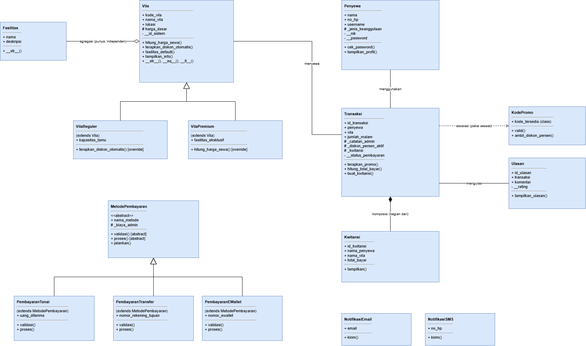
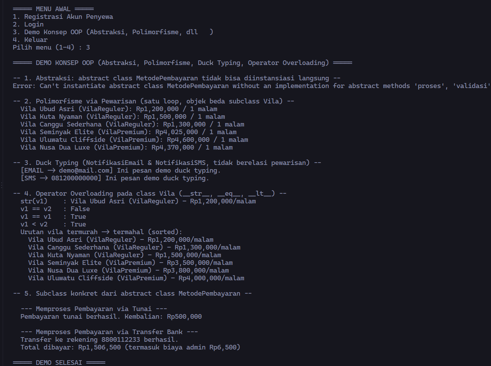

# SIREVA (Sistem Reservasi Penyewaan Villa)

---

## 1. Penjelasan Program

SIREVA merupakan sistem reservasi penyewaan vila yang berlokasi di kawasan Bali, dengan dua peran pengguna yang terpisah, yaitu Penyewa dan Admin.

Alur kerja program adalah sebagai berikut:
1. Penyewa diwajibkan melakukan registrasi akun (nama, nomor HP, NIK, username, password) terlebih dahulu sebelum dapat menyewa vila.
2. Penyewa melakukan login melalui satu pintu masuk yang sama. Sistem akan mendeteksi secara otomatis apakah kredensial yang dimasukkan merupakan milik Admin atau Penyewa, tanpa menu login yang terpisah.
3. Penyewa memilih tipe vila (Reguler atau Premium), kemudian memilih salah satu vila dari daftar sesuai tipe yang dipilih. Seluruh vila yang tersedia berlokasi di Bali dan masing-masing memiliki daftar fasilitas.
4. Penyewa dapat memasukkan kode promo secara opsional sebelum sistem menghitung total biaya (subtotal dikurangi diskon, ditambah pajak).
5. Penyewa memilih metode pembayaran (Tunai, Transfer Bank, atau E-Wallet), atau dapat menundanya terlebih dahulu.
6. Apabila pembayaran ditunda, penyewa dapat melunasinya di kemudian waktu melalui menu "Bayar Transaksi Tertunda". Menu ini hanya akan muncul apabila terdapat transaksi yang berstatus menunggu pembayaran.
7. Setelah status transaksi berubah menjadi Lunas, sistem akan mencetak kwitansi, mengirimkan notifikasi konfirmasi, lalu menampilkan formulir ulasan secara otomatis (pengisian ulasan bersifat opsional).
8. Admin melakukan login menggunakan kredensial tetap (`onall` / `23`) tanpa perlu melakukan registrasi, dan memiliki menu berbeda, yaitu melihat seluruh transaksi, melihat seluruh ulasan, mengubah persentase pajak, mengurutkan dan membandingkan vila, serta melihat statistik sistem.
9. Tersedia pula menu "Demo Konsep OOP" pada Menu Awal yang menjalankan demonstrasi langsung atas penerapan abstraksi, polimorfisme, duck typing, dan operator overloading dalam satu rangkaian keluaran.

---

## 2. Struktur Class

### Inheritance: `Vila` (superclass) menurunkan `VilaReguler` dan `VilaPremium` (subclass)

`Vila` berperan sebagai superclass yang menyimpan data umum dari suatu vila.
- Atribut kelas: `nama_perusahaan`, `total_vila_terdaftar`, `pajak_persen`
- Atribut instance: `kode_vila`, `nama_vila`, `lokasi` (bersifat public), `_harga_dasar`, `_daftar_fasilitas` (bersifat protected, dapat diakses oleh subclass), `__id_sistem` (bersifat private, hanya digunakan di dalam class `Vila`)
- Instance method: `tambah_fasilitas()`, `hitung_harga_sewa()`, `fasilitas_default()`, `terapkan_diskon_otomatis()`, `tampilkan_info()`, serta magic method `__str__()`, `__eq__()`, dan `__lt__()`
- Class method: `ubah_pajak()`
- Static method: `validasi_kode_vila()`

`VilaReguler(Vila)` merupakan subclass yang menambahkan atribut unik `kapasitas_tamu`. Subclass ini meng-override method `fasilitas_default()` agar vila reguler otomatis dilengkapi fasilitas dasar, serta meng-override `terapkan_diskon_otomatis()` untuk memberikan diskon sebesar 10% apabila masa menginap mencapai lima malam atau lebih. Konstruktornya memanggil `super().__init__(...)`.

`VilaPremium(Vila)` merupakan subclass yang menambahkan atribut unik `fasilitas_eksklusif`. Subclass ini juga meng-override `fasilitas_default()` dengan fasilitas yang lebih lengkap, serta meng-override method `hitung_harga_sewa()` milik superclass dengan menambahkan biaya layanan premium sebesar 15% di atas harga dasar. Konstruktornya juga memanggil `super().__init__(...)`.

### Abstraksi: `MetodePembayaran` (abstract class) menurunkan `PembayaranTunai`, `PembayaranTransfer`, dan `PembayaranEWallet`

`MetodePembayaran` merupakan abstract class yang dibangun menggunakan `from abc import ABC, abstractmethod`, sehingga tidak dapat diinstansiasi secara langsung.
- Atribut kelas: `total_pembayaran_diproses`
- Atribut instance: `nama_metode` (bersifat public), `_biaya_admin` (bersifat protected)
- Abstract method: `validasi()` dan `proses()`, yang wajib diimplementasikan oleh setiap subclass
- Concrete method: `jalankan()`, yaitu method bersama yang dipakai seluruh subclass tanpa perlu ditulis ulang. Method ini memanggil `validasi()` terlebih dahulu, kemudian baru memanggil `proses()` apabila validasi berhasil

`PembayaranTunai(MetodePembayaran)` mengimplementasikan `validasi()` dengan memeriksa apakah uang yang diterima mencukupi, dan `proses()` dengan menghitung kembalian.

`PembayaranTransfer(MetodePembayaran)` mengimplementasikan `validasi()` dan `proses()` dengan menambahkan biaya admin transfer pada atribut protected `_biaya_admin`.

`PembayaranEWallet(MetodePembayaran)` mengimplementasikan `validasi()` dan `proses()` dengan skema biaya admin yang berbeda, sehingga menambah variasi perilaku tanpa mengubah satu baris kode pun pada `MetodePembayaran`.

### `Penyewa`

Merepresentasikan akun penyewa yang terdiri atas data diri dan kredensial login.
- Atribut kelas: `total_penyewa`, `jenis_keanggotaan_default`, `minimal_umur_sewa`
- Atribut instance: `nama`, `no_hp`, `username` (bersifat public), `_jenis_keanggotaan` (bersifat protected), `__nik`, `__password` (bersifat private, diakses melalui `@property`)
- Instance method: `cek_password()`, `tampilkan_profil()`
- Class method: `dari_dict()` (factory method)
- Static method: `validasi_no_hp()`

### `Transaksi`

Menghubungkan objek `Penyewa` dan objek `Vila` dalam satu transaksi penyewaan.
- Atribut kelas: `total_transaksi`, `denda_per_hari_telat`, `status_valid`
- Atribut instance: `id_transaksi`, `penyewa`, `vila`, `jumlah_malam` (bersifat public), `_catatan_admin`, `_diskon_persen_aktif`, `_kwitansi` (bersifat protected), `__status_pembayaran` (bersifat private, diakses melalui `@property`)
- Instance method: `terapkan_promo()`, `hitung_total_bayar()`, `buat_kwitansi()`
- Class method: `buat_transaksi()` (factory method disertai validasi)
- Static method: `validasi_jumlah_malam()`

### `Ulasan`

Menyimpan ulasan yang diberikan penyewa terhadap vila, yang terhubung dengan objek `Transaksi` yang telah berstatus lunas.
- Atribut kelas: `total_ulasan`, `rating_min`, `rating_max`
- Atribut instance: `id_ulasan`, `transaksi`, `komentar` (bersifat public), `__rating` (bersifat private, diakses melalui `@property`)
- Instance method: `tampilkan_ulasan()`
- Class method: `buat_dari_transaksi()` (factory method dengan aturan bisnis bahwa transaksi terkait harus berstatus lunas)
- Static method: `validasi_komentar()`

### `Fasilitas`, `KodePromo`, dan `Kwitansi`

Tiga class pendukung yang masing-masing merepresentasikan satu bentuk relasi UML, sebagaimana dijelaskan pada bagian berikutnya.

### `NotifikasiEmail` dan `NotifikasiSMS`

Dua class yang tidak memiliki relasi pewarisan satu sama lain, namun sama-sama memiliki method `kirim(pesan)`. Keduanya dipakai sebagai contoh penerapan duck typing, sebagaimana dijelaskan pada bagian 4.

---

## 3. Relasi UML Class Diagram yang Diterapkan

Diagram kelas berikut menggambarkan seluruh class beserta atribut dan method utamanya, lengkap dengan simbol relasi Asosiasi, Agregasi, Komposisi, dan Inheritance.



Berkas sumber diagram dibuat dengan draw.io dan tersedia pada `diagram_class.drawio` (dapat dibuka dan diedit di diagrams.net).

### Asosiasi ("menggunakan")

Method `Transaksi.terapkan_promo(kode_promo)` menerima objek `KodePromo` sebagai parameter. Objek tersebut hanya digunakan sesaat untuk mengambil nilai persentase diskon, kemudian dilepaskan kembali. Objek `KodePromo` tidak disimpan sebagai atribut permanen pada `Transaksi`; yang disimpan hanyalah nilai `_diskon_persen_aktif`. Relasi ini dipilih sebagai asosiasi, bukan agregasi atau komposisi, karena hubungan antara `Transaksi` dan `KodePromo` hanya berlangsung sesaat pada satu pemanggilan method dan tidak membentuk kepemilikan apa pun.

### Agregasi ("memiliki")

Class `Vila` memiliki atribut `_daftar_fasilitas` yang menampung sejumlah objek `Fasilitas`. Objek-objek `Fasilitas` (misalnya WiFi, AC, Kolam Renang) dibuat secara terpisah di luar class `Vila` pada level modul, kemudian didaftarkan ke suatu vila melalui method `tambah_fasilitas()`. Relasi ini dipilih sebagai agregasi, bukan komposisi, karena objek `Fasilitas` memiliki siklus hidup yang independen terhadap objek `Vila` yang menggunakannya; satu objek `Fasilitas` yang sama (misalnya WiFi) dapat dipakai oleh lebih dari satu vila sekaligus, dan tetap dapat berdiri sendiri meski objek `Vila` tersebut dihapus.

### Komposisi ("terdiri dari")

Method `Transaksi.buat_kwitansi()` membuat objek `Kwitansi` secara langsung di dalam method tersebut, bukan menerimanya dari luar. Relasi ini dipilih sebagai komposisi, bukan agregasi, karena objek `Kwitansi` sepenuhnya bergantung pada `Transaksi` yang membuatnya; objek `Kwitansi` tidak memiliki arti maupun kegunaan di luar konteks transaksi yang membentuknya, dan siklus hidupnya menyatu dengan siklus hidup `Transaksi` tersebut.

### Inheritance / Pewarisan ("adalah jenis dari")

Class `VilaReguler` dan `VilaPremium` merupakan jenis dari class `Vila`, sedangkan `PembayaranTunai`, `PembayaranTransfer`, dan `PembayaranEWallet` merupakan jenis dari abstract class `MetodePembayaran` (lihat bagian 2 dan 4). Relasi ini merupakan satu-satunya relasi yang menghubungkan antarkelas (class-to-class), berbeda dengan tiga relasi lainnya yang menghubungkan antarobjek (object-to-object).

---

## 4. Penerapan Abstraksi dan Polimorfisme

### Abstraksi

Abstraksi diterapkan melalui abstract class `MetodePembayaran`, yang dibangun dengan `from abc import ABC, abstractmethod` dan memiliki dua abstract method, yaitu `validasi()` dan `proses()`. Abstract class ini juga memiliki satu concrete method bersama, yaitu `jalankan()`, yang dipakai oleh seluruh subclass tanpa perlu ditulis ulang: method ini memanggil `validasi()` lalu `proses()` sesuai urutan yang sama, apa pun jenis metode pembayarannya.

Abstract class `MetodePembayaran` tidak dapat diinstansiasi secara langsung. Hal ini dibuktikan melalui blok `try/except TypeError` pada fungsi `demo_konsep_oop()`, yang mencoba membuat objek `MetodePembayaran('Testing')` secara langsung dan menangkap `TypeError` yang dilemparkan Python. Keluaran pembuktian ini dapat dilihat pada bagian 5 (Screenshot Output Program).

Tiga subclass konkret, yaitu `PembayaranTunai`, `PembayaranTransfer`, dan `PembayaranEWallet`, masing-masing mengimplementasikan `validasi()` dan `proses()` dengan caranya sendiri, serta tetap mengikuti aturan pewarisan yang sama seperti hierarki `Vila`: setiap subclass memiliki atribut unik, memanggil `super().__init__(...)`, dan menggunakan atribut protected `_biaya_admin` secara konsisten.

### Polimorfisme

Polimorfisme diterapkan dalam tiga bentuk pada program ini.

Pertama, polimorfisme melalui pewarisan (method overriding). Method `hitung_harga_sewa()` dipanggil melalui satu loop yang sama pada fungsi `demo_konsep_oop()` dan `admin_urutkan_vila()`, yang mengiterasi daftar `daftar_vila` berisi campuran objek `VilaReguler` dan `VilaPremium`. Setiap objek menghitung harga sewanya sendiri sesuai implementasi method pada classnya masing-masing, tanpa pengecekan tipe apa pun di dalam loop tersebut.

Kedua, duck typing. Class `NotifikasiEmail` dan `NotifikasiSMS` tidak memiliki relasi pewarisan satu sama lain, namun keduanya sama-sama memiliki method `kirim(pesan)`. Fungsi `kirim_notifikasi_konfirmasi(daftar_kanal, pesan)` memanggil `kanal.kirim(pesan)` untuk setiap objek dalam `daftar_kanal` tanpa mempedulikan tipe objeknya, selama objek tersebut memiliki method `kirim()`.

Ketiga, operator overloading. Class `Vila` memiliki magic method `__str__()` (untuk menampilkan representasi vila sebagai teks), `__eq__()` (untuk membandingkan dua vila berdasarkan `kode_vila`), dan `__lt__()` (untuk membandingkan dua vila berdasarkan harga, sehingga daftar vila dapat diurutkan langsung menggunakan fungsi bawaan `sorted()` pada menu "Urutkan & Bandingkan Vila").

Program ini secara sengaja tidak menggunakan percabangan `if/elif` yang memeriksa `type()` objek atau field bertipe string seperti "jenis" untuk membedakan perilaku antarobjek. Setiap perbedaan perilaku, baik pada perhitungan harga, pemberian diskon, pemilihan fasilitas default, maupun pemrosesan pembayaran, ditentukan sepenuhnya oleh method milik objek itu sendiri melalui mekanisme polimorfisme.

---

## 5. Screenshot Output Program

Gambar berikut merupakan tangkapan keluaran dari menu "Demo Konsep OOP", yang mencakup pembuktian `TypeError` saat `MetodePembayaran` dicoba diinstansiasi langsung, polimorfisme melalui pewarisan, duck typing, dan operator overloading.



Catatan: gambar di atas dihasilkan dari keluaran program yang sesungguhnya (bukan rekaan), dengan tampilan menyerupai jendela terminal agar mudah dibaca. Apabila aslab mewajibkan tangkapan layar asli dari perangkat sendiri, gambar ini dapat digantikan dengan screenshot pribadi dari hasil menjalankan menu yang sama.

---

## 6. Penerapan SOLID (Nilai Tambah)

Program ini menerapkan Open/Closed Principle (OCP) pada hierarki `MetodePembayaran`. Class `MetodePembayaran` beserta method `jalankan()` tidak perlu diubah sama sekali ketika dibutuhkan metode pembayaran baru; penambahan `PembayaranEWallet` sebagai metode pembayaran ketiga cukup dilakukan dengan membuat satu subclass baru yang mengimplementasikan `validasi()` dan `proses()`, tanpa menyentuh kode `PembayaranTunai`, `PembayaranTransfer`, maupun `MetodePembayaran` itu sendiri. Dengan demikian, class `MetodePembayaran` bersifat tertutup terhadap perubahan (closed for modification) namun tetap terbuka terhadap perluasan (open for extension), sesuai definisi OCP.

---

## 7. Panduan Pengujian

### Cara Menjalankan Program
```bash
python posttest3_2509106111_FarelRonalvi.py
```

### Kredensial Admin (bersifat tetap, tanpa registrasi)
- Username: `onall`
- Password: `23`

### Kode Promo yang Tersedia untuk Pengujian
- `SIREVA10` memberikan diskon 10%
- `LIBURAN20` memberikan diskon 20%
- `BALIHEMAT15` memberikan diskon 15%

### Skenario Pengujian yang Disarankan

1. Registrasi dan validasi data
   - Pilih menu `1. Registrasi Akun Penyewa`
   - Cobalah memasukkan nomor HP yang tidak diawali `08`, untuk memastikan sistem menolak input tersebut dan meminta pengisian ulang
   - Lanjutkan dengan data yang valid hingga akun berhasil dibuat

2. Penyewaan Vila Reguler dengan diskon long-stay
   - Pilih menu `1. Sewa Vila`, kemudian pilih tipe `Reguler`, pilih salah satu vila, dan masukkan jumlah malam sebanyak 5 malam atau lebih
   - Perhatikan pesan diskon long-stay sebesar 10% yang muncul secara otomatis, yang dihasilkan melalui method `terapkan_diskon_otomatis()` pada `VilaReguler`

3. Penyewaan Vila Premium dan pengecekan override harga
   - Ulangi proses penyewaan, kali ini dengan memilih tipe `Premium`
   - Perhatikan subtotal yang ditampilkan; subtotal pada vila Premium akan lebih besar karena terdapat tambahan 15% biaya layanan dari method `hitung_harga_sewa()` yang telah di-override

4. Pengujian kode promo
   - Pada saat ditanya "Punya kode promo?", jawab `y` kemudian masukkan salah satu kode promo di atas, dan pastikan sistem menampilkan potongan diskon pada rincian transaksi
   - Cobalah pula memasukkan kode promo yang tidak valid untuk memastikan sistem menolaknya tanpa memberikan diskon

5. Pengujian metode pembayaran (Abstraksi)
   - Pada saat memilih metode pembayaran, cobalah ketiga pilihan secara bergantian, yaitu Tunai, Transfer Bank, dan E-Wallet, lalu perhatikan perbedaan cara masing-masing memproses pembayaran
   - Pada pembayaran Tunai, cobalah memasukkan uang yang kurang dari total tagihan untuk menguji bahwa `validasi()` menolak pembayaran tersebut

6. Pembayaran langsung dan pembayaran yang ditunda
   - Pilih salah satu metode pembayaran hingga berhasil untuk menguji status berubah menjadi Lunas, kwitansi tercetak, notifikasi terkirim, dan formulir ulasan muncul secara otomatis
   - Pada percobaan lain, pilih opsi "Belum, tunda pembayaran", kemudian kembali ke Menu Penyewa dan perhatikan menu "Bayar Transaksi Tertunda" yang muncul secara otomatis. Selesaikan pembayaran melalui menu tersebut

7. Pemeriksaan riwayat transaksi
   - Pilih menu `2. Riwayat Transaksi Saya` untuk melihat seluruh transaksi milik akun yang sedang digunakan

8. Login sebagai Admin
   - Lakukan logout dari akun Penyewa
   - Login menggunakan username `onall` dan password `23`
   - Ujilah seluruh menu Admin, yaitu melihat seluruh transaksi, melihat seluruh ulasan, mengubah pajak sewa, mengurutkan dan membandingkan vila (operator overloading), serta melihat statistik sistem

9. Pengujian login gabungan
   - Pada Menu Awal, pilih menu `2. Login`, kemudian cobalah memasukkan username atau password yang salah untuk memastikan sistem menolak dan meminta pengisian ulang
   - Lakukan login kembali menggunakan akun Penyewa yang telah terdaftar untuk memastikan proses login berhasil masuk ke Menu Penyewa

10. Demo Konsep OOP
    - Dari Menu Awal, pilih menu `3. Demo Konsep OOP`
    - Amati kelima bagian keluaran secara berurutan: pembuktian `TypeError` pada abstract class, polimorfisme melalui pewarisan, duck typing, operator overloading, dan pemanggilan dua subclass `MetodePembayaran`
